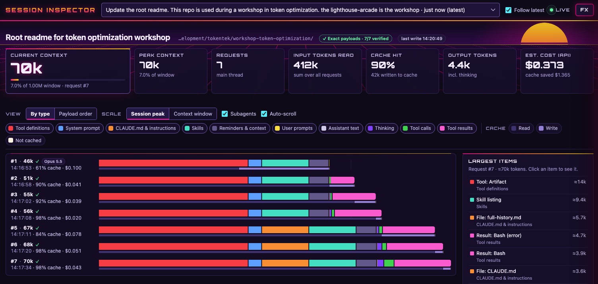

# Workshop: token optimization

The material for the Claude Code workshop "How you get more done on fewer tokens".

This repo has two parts:

| Folder | What it is | Read |
|---|---|---|
| [`lighthouse-arcade/`](lighthouse-arcade/) | The workshop app and lab kit: a small arcade of browser games, the labs, the user stories and the facilitator material | [`lighthouse-arcade/README.md`](lighthouse-arcade/README.md) |
| [`session-inspector/`](session-inspector/) | A local dashboard that shows what is inside your Claude Code session files: system prompt, tools, CLAUDE.md, prompts, cache use and cost per request | [`session-inspector/README.md`](session-inspector/README.md) |

All code in this repo is fictional. Use it to practice. Do not put company code or company data in it.

## Lighthouse Arcade

Lighthouse Arcade is the app that you work on in the labs. Each game is one HTML file with inline CSS and JavaScript. There is no build, no package manager and no server.

- `labs/`: Lab 1 (look inside your session), Lab 2 (build and measure the snake game) and Lab 3 (audit a CLAUDE.md), with the token card, scoring checklist and command card.
- `stories/`: the user stories SNAKE-01 to SNAKE-08 and the race prompt for Lab 2.
- `tools/`: the precheck, the status line, `race.sh` for headless runs and `open-game.sh`.
- `facilitator/`: the run sheet, seating and the board template.
- `solution/`: the fixed CLAUDE.md and the list of planted flaws. Do not open it before Lab 3.

The `CLAUDE.md` in `lighthouse-arcade/` is weak on purpose. It has 12 planted flaws that you fix in Lab 3. Do not copy it to your own repo.

Start with the prerequisites and prework in [`lighthouse-arcade/README.md`](lighthouse-arcade/README.md).

## Session Inspector

Session Inspector reads the JSONL session logs that Claude Code writes to `~/.claude/projects` and shows each API request as one bar. You can see the context grow, what is cached and what each request costs. Use it next to Lab 1 and Lab 2.



It needs Python 3.9 or newer and nothing else:

```bash
cd session-inspector
python3 serve.py        # Windows: py serve.py
```

The browser opens `http://127.0.0.1:8765`. Then use Claude Code as usual in another terminal. Install help, options and what the dashboard shows are in [`session-inspector/README.md`](session-inspector/README.md).

## Do not add a CLAUDE.md at the root

Claude Code loads every `CLAUDE.md` in the parent folders of the folder where you start it. A `CLAUDE.md` here would load in every Lab 2 session and change the token numbers. `tools/precheck.sh` checks for it.
